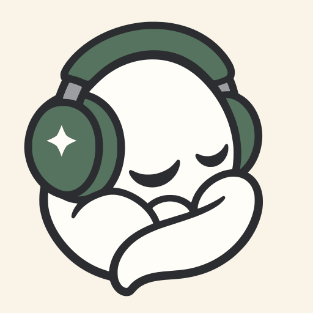

<p align="center">
  
</p>

<h1 align="center">appearoffline: guard</h1>

<p align="center">
  A gentle little browser extension for the moments your hand opens Twitter before your brain has a say.
</p>

---

## Why this exists

You know the loop: you're anxious or bored, you open the same site for the fifth time in an hour, scroll, feel a bit worse, close it, repeat. Hard blockers don't really help — you just turn them off. Pure willpower doesn't either.

**appearoffline: guard** sits in the middle. It doesn't forbid anything. It just asks you to stop for a second, breathe, and say out loud (well, in writing) why you're here. Most of the time that's enough to notice you didn't actually want to go there.

Meet the ghost. It's sleeping with its headphones on while you wait — and when the pause is over, it opens its eyes and smiles at you. 👻

## What it does

- **A 30-second breather.** When you hit a blocked site you get a calm breathing ring instead of the page. If you switch tabs, the countdown waits for you.
- **"Why are you here?"** Before going in, you pick what's pulling you — *need*, *boredom*, *rumination* or *other* — and write a sentence about it.
- **A history you can actually learn from.** A separate history page shows how often you went in out of boredom versus real need, today, this week, this month or all time.
- **Strict mode with one-time codes (optional).** For the days you don't trust yourself: every unlock needs a code, and the codes live with your AI assistant or a friend, not with you.
  - Generate a batch of 50 codes and paste the block into any AI chat. You can't read the codes; the AI can, and hands them out one at a time after asking why.
  - A valid code lets you in right away — no 30-second wait, but you still log the reason.
  - Lost your codes? Ask for an **emergency unlock**. It works without a code, just not right now: 24 hours after you request it.
- **Short, timed unlocks.** Choose 5, 10, 15 or 30 minutes; when time is up, open tabs get blocked again.
- **Light and dark themes, five languages** (Polish, English, Spanish, French, German).

## Try it locally

```bash
npm install
npm run build
```

That builds both versions into `dist/chrome` and `dist/firefox`.

**Chrome, Edge, Brave, Arc**
1. Open `chrome://extensions`.
2. Turn on **Developer mode**.
3. Click **Load unpacked** and pick the `dist/chrome` folder.
4. Pin the ghost to your toolbar — clicking it opens the settings.

**Firefox**
1. Open `about:debugging#/runtime/this-firefox`.
2. Click **Load Temporary Add-on…** and pick `dist/firefox/manifest.json`.

After changing code, run `npm run build` again and hit the reload button on the extension.

For development: `npm run lint` and `npm test`.

## Credits

Built on top of [penge/block-site](https://github.com/penge/block-site) by Pavel Bucka (MIT). The ghost was drawn for this project and lives in [`assets/`](assets/).

## License

MIT
